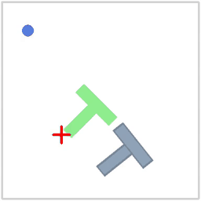
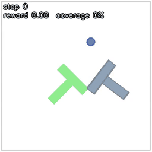

# tiny-vla

A hands-on learning project for robot imitation learning with
[Hugging Face LeRobot](https://github.com/huggingface/lerobot), built up in small parts toward
vision-language-action (VLA) models. It starts with **PushT**, a 2D simulated task where a round
agent has to push a T-shaped block onto a green target.

The code favors small, readable scripts over abstractions: the point is to understand every line,
including the parts LeRobot normally hides (observation mapping, normalization, action chunking).

<p align="center">
  
  <br>
  <em>The pretrained <code>lerobot/diffusion_pusht</code> policy solving PushT. The red cross is the
  current action: the target position the agent is being pulled toward.</em>
</p>

## Status

| Part | Topic | Status |
|---|---|---|
| 1 | Explore the `lerobot/pusht` dataset | Done |
| 2 | Hand-written rollout loop for a pretrained diffusion policy, checked against `lerobot-eval` | Done |
| 3 | Train ACT on a 4 GB GPU and evaluate every checkpoint | Done (15% success; needs longer training) |

## Setup

Requires [uv](https://docs.astral.sh/uv/). Everything is pinned: `lerobot[pusht,diffusion,training]==0.6.1`
on Python 3.12. The LeRobot API changes between versions, so the code is written against the
installed 0.6.1 source, not the docs.

```bash
uv sync                                   # creates .venv and installs everything
uv run python scripts/check_env.py        # lerobot / torch versions, device, gym_pusht import
uv run python scripts/prepare_policy.py   # once: convert lerobot/diffusion_pusht for lerobot 0.6.1 (Part 2)
```

`check_env.py` prints the device it would use (cuda, mps, or cpu). The Part 2 and 3 scripts
default to CUDA and **stop with an error instead of silently falling back to CPU**; pass
`--device mps` or `--device cpu` to choose one on purpose.

**Hardware used:** a Linux laptop (WSL2) with a 4 GB RTX 3050 and only 3.5 GB of system RAM for
WSL, plus a Mac M3 (16 GB) for development. Several choices below exist because of that RAM limit.

## Part 1: the dataset

```bash
uv run python scripts/explore_dataset.py
```

Loads `lerobot/pusht` with `LeRobotDataset`, prints its features and normalization stats, and
saves plots to `outputs/part1/`: a frame grid, state vs action over time, agent trajectories, and
episode lengths. It then reloads the dataset with `delta_timestamps` to show how one sample
becomes a window of frames.

- **206 episodes, 25,650 frames at 10 fps.** Episodes run 49–246 frames (mean 125).
- **Observations:** a 96x96 RGB image plus the agent's (x, y). **Action:** a target (x, y) in the
  512x512 workspace, not a velocity. A PD controller in the env pulls the agent toward it, so the
  action leads the state by about 2 steps.
- **`delta_timestamps`** turns single frames into windows: 2 observations (`(2, 3, 96, 96)`) and a
  chunk of 16 actions (`(16, 2)`), plus `*_is_pad` masks for positions outside the episode.

## Part 2: a hand-written rollout loop

`src/tiny_vla/rollout.py` runs one episode step by step, with each step commented: reset, map
simulator keys to policy keys (`pixels` to `observation.image`, uint8 HWC to float CHW), normalize,
`select_action`, unnormalize, step the sim. Forward hooks count how often the model actually runs,
and it records peak GPU memory.

```bash
uv run python scripts/watch.py                       # live OpenCV window (q quit, r reset), if $DISPLAY is set
uv run python scripts/watch.py --save --episodes 3   # MP4s with overlays to outputs/part2/videos/
uv run python scripts/sweep_action_steps.py          # n_action_steps in [1, 4, 8, 16], 10 seeds each
```

The viewer overlays the step count, reward and coverage, and the action chunk the policy has
queued: the big dot is the current target and the smaller dots are the upcoming ones.

**Results** (pretrained `lerobot/diffusion_pusht`, seeds 1000–1009):

| | success | notes |
|---|---|---|
| my rollout loop (`n_action_steps=8`) | **80%** (8/10) | 29 model calls per episode vs 231 env steps; 1.1 GB peak VRAM |
| `lerobot-eval` on the same seeds | 70% (7/10) | |
| reported on the Hub (500 episodes) | 65.4% | |

With 10 episodes, one episode is 10 points, so these agree. Every model call is 100 denoising
passes of the U-Net, which is why action chunking matters: executing 8 actions per prediction
cuts the model work 8x.

**How many actions to execute per prediction** (`sweep_action_steps.py`, same 10 seeds):

| n_action_steps | 1 | 4 | **8** | 16 (really 15) |
|---|---|---|---|---|
| success | 40% | 20% | **80%** | 40% |
| avg max coverage | 0.93 | 0.82 | 0.91 | 0.84 |
| model calls per episode | 265 | 67 | 29 | 16 |
| seconds per episode | 607 | 156 | 68 | 37 |

The checkpoint's own setting of 8 was clearly best. Executing 15 actions blind reacts too slowly,
but re-planning *more* often was also worse: every chunk starts from fresh random noise, so frequent
re-planning keeps switching strategies instead of committing to one. At `n=1` the policy got the
block almost into place (the highest coverage) but often dithered just short of the 95% success
line, at 16x the cost of `n=16`. With 10 episodes per setting, only the gap between 8 and the rest
is clearly real.

## Part 3: training ACT

```bash
uv run python scripts/print_act_config.py     # default ACT config + parameter count
uv run python scripts/inspect_act_shapes.py   # tensor shapes through one training pass
uv run python scripts/probe_batch_size.py     # peak VRAM and speed for batch sizes 8-64
tmux new -s act-train 'bash configs/act_pusht.sh'   # train (~50 min), logs GPU use to a CSV
uv run python scripts/eval_checkpoints.py     # evaluate every checkpoint, plot loss vs success
```

- **ACT (Action Chunking Transformer)** has 51.6M parameters: a ResNet18 image encoder, a
  transformer encoder and decoder, and a CVAE encoder that is only used during training.
- **Shapes:** the ResNet reduces a 96x96 image to a 3x3 feature map, so the transformer encoder
  works on only 11 tokens (latent, state, 9 image patches). The decoder turns `chunk_size` learned
  queries into `chunk_size` actions.
- **Chunk size:** ACT's default of 100 actions assumes a 50 fps robot (2 s). At PushT's 10 fps that
  would be 10 s, nearly a whole demo, so training uses `chunk_size=20` (2 s) and executes 10 actions
  (1 s) before re-planning.
- **Batch size:** the probe showed batch 64 fits in VRAM (2.1 GB of 4 GB), but the first run at 64
  with 2 dataloader workers crashed the whole WSL VM by running out of *system* RAM. The run in
  progress uses batch 8 and 1 worker. The batch itself was never the problem (a sample is ~28 KB):
  each dataloader worker is a separate process that re-imports torch, which costs hundreds of MB.

<p align="center">
  
  <br>
  <em>The ACT policy trained here (step 25k) on one of its successful seeds. The red dot is the
  current target, and the yellow dots are the rest of the queued action chunk.</em>
</p>

**Results** (30k steps at batch 8, 50 min on the RTX 3050; 20 fixed seeds per checkpoint):

| checkpoint | 5k | 10k | 15k | 20k | 25k | 30k |
|---|---|---|---|---|---|---|
| success | 0% | 0% | 5% | 10% | **15%** | 15% |
| avg max coverage | 0.28 | 0.35 | 0.49 | 0.49 | **0.58** | 0.54 |

- **Loss and success don't track each other.** Training loss fell smoothly from 15.2 to 0.12, but
  success stayed low. The loss measures copying the human's next 20 moves from recorded states; a
  rollout measures recovering from states the policy got itself into. Coverage is the more
  informative curve early on.
- **Failure mode:** ACT moves the block onto the target but often can't rotate it into place, then
  keeps pushing at the same spot until time runs out.
- **The CVAE latent collapsed:** the KL term dropped to ~0.002 and stayed there, so the latent
  carries almost no information and this ACT behaves like a plain deterministic policy.
- **GPU utilization averaged 49%,** but not because of the dataloader: each step waited 2.8 ms for
  data vs 88 ms of compute. Batch 8 is simply too small to keep the GPU busy. Since the batch was
  never the RAM problem, a bigger batch (32-64) with 1 worker is the obvious next run.

Only 240k samples were seen (about 9 passes over the data) and success was still rising, so the
first thing to try is training longer with a bigger batch.

## Layout

```
src/tiny_vla/
  device.py          pick the torch device; refuse to silently fall back to CPU
  policy.py          load a saved policy folder (diffusion or ACT) with its pre/post processors
  rollout.py         the hand-written rollout loop and its instrumentation
  video.py           draw overlays on frames, record an episode to MP4
  act.py             build ACT, its dataset, preprocessor and optimizer the way lerobot-train does
scripts/
  check_env.py           environment check
  explore_dataset.py     Part 1
  prepare_policy.py      convert the Hub diffusion checkpoint to lerobot 0.6.1's processor format
  watch.py               live viewer / MP4 recorder
  sweep_action_steps.py  Part 2 n_action_steps sweep
  print_act_config.py    Part 3: ACT config and parameter counts
  inspect_act_shapes.py  Part 3: shape trace via forward hooks
  probe_batch_size.py    Part 3: VRAM and speed per batch size
  eval_checkpoints.py    Part 3: evaluate checkpoints, plot loss vs success
  log_gpu.sh             sample nvidia-smi into a CSV
configs/act_pusht.sh     the lerobot-train command for Part 3, with the reasoning for each flag
examples/                media used in this README
outputs/                 everything generated: plots, CSVs, checkpoints, videos, notes (gitignored)
```

## Things that went wrong (and are handled in the code)

- **The Hub diffusion checkpoint predates lerobot 0.6.** It stores normalization stats inside the
  model weights, and 0.6.1 silently drops them on load. `prepare_policy.py` moves them into the
  new processor files. lerobot's own migration script crashes on this checkpoint (it keeps
  `crop_shape` as a list, which the config parser can't encode).
- **Two OpenCV packages overwrite each other.** lerobot needs `opencv-python-headless` and
  gym-pusht needs `opencv-python`; both install to `cv2/`, and the headless one has no GUI. A uv
  override in `pyproject.toml` keeps a single GUI build at lerobot's tested version.
- **`lerobot-eval` on 3.5 GB of RAM** needs `--eval.use_async_envs=false` (one process per env ran
  out of memory) and a small `--eval.batch_size` (it buffers every rendered video frame in RAM).
- **torchcodec can't load its libraries** on this machine, so datasets use `video_backend="pyav"`.
- **In lerobot 0.6.1** the training flag is `--env_eval_freq` (there is no `eval_freq`), and
  `lerobot-train` refuses to start if the output folder already exists.
- **Diffusion's `n_action_steps` is capped at 15, not 16:** it predicts 16 actions starting one step
  in the past, so asking for 16 still executes 15.
